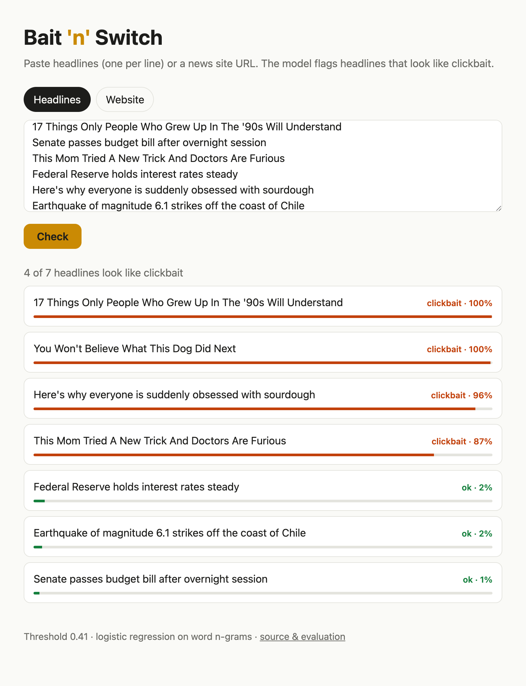
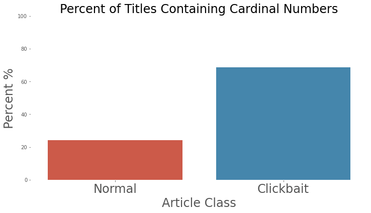
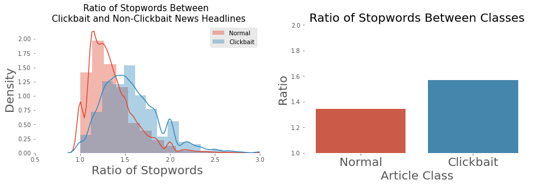

# Bait 'n' Switch

**Clickbait detection for headlines: a tested Python API and a Chrome extension that runs the model entirely in your browser.**

<picture>
  <source media="(prefers-color-scheme: dark)" srcset="docs/images/demo-dark.png">
  
</picture>

This started as my Flatiron School data science capstone in January 2021. In 2026 I went back to it, found that the headline result didn't hold up, and rebuilt it. The [original work is preserved in `archive/2021-capstone`](archive/2021-capstone/); the sections below explain what changed and why.

## What it does

- **Chrome extension** ([`extension/`](extension/)): click the corn on any news site and every headline that reads like clickbait is highlighted with a probability badge, blurred (hover to reveal), or hidden along with its story card. A sensitivity slider sets how much goes, and "Show everything" puts it all back. The model ships inside the extension as 1.5 MB of weights, so no page content leaves your browser and it needs only the `activeTab` permission.
- **JSON API** ([`baitnswitch/app.py`](baitnswitch/app.py)): score headlines you send, or give it a URL and it fetches the page, extracts the headlines and scores them.
- **Training pipeline** ([`baitnswitch/train.py`](baitnswitch/train.py)): one command that rebuilds the model, the extension weights and the [evaluation report](reports/metrics.md).

## Results

Held-out test set (15% of the data, untouched until the final run). The decision threshold of 0.41 was chosen on a separate validation split.

| Dataset | What it is | F1 | ROC AUC |
|---|---|---:|---:|
| Chakraborty et al. 2016 | 32k headlines, labelled by *source* (BuzzFeed vs. NYT) | 0.972 | 0.996 |
| Webis-Clickbait-16 | 2.9k tweets from news publishers, human-rated | 0.607 | 0.804 |
| Webis-Clickbait-17 | 19k tweets from news publishers, human-rated | 0.595 | 0.828 |
| All combined | | 0.870 | 0.959 |

**Read the Webis rows, not the Chakraborty one.** Chakraborty labels a headline clickbait if it came from BuzzFeed, Upworthy and similar sites, and not if it came from the New York Times or the Guardian. A model can score 0.97 there by learning publisher house style. The Webis corpora put headlines from the *same* mainstream publishers in front of human raters, which is the problem the extension actually faces. A model trained only on Chakraborty manages F1 0.51 on Webis-17 ([cross-dataset results](reports/metrics.md#cross-dataset-generalization-threshold-05)).

For context, the best systems in the 2017 Clickbait Challenge, built on Webis-17, reached F1 of roughly 0.68 with considerably heavier models.

## What changed from the 2021 version

| | 2021 | 2026 |
|---|---|---|
| Headline metric | F1 0.88 on combined data | Per-dataset F1, Webis reported first |
| Webis-17 F1 | 0.25 | **0.595** |
| Webis training text | The linked article's title | The tweet the annotators actually rated |
| Threshold and tuning | Default 0.5; some cross-validation was done on the test set | Chosen on validation; test scored once |
| Preprocessing | Different in the API and the web form | One `normalize()`, used by training, the API and the extension (checked by a parity test) |
| Deployed model | A BernoulliNB that wasn't the one in the README | The pipeline the report describes |
| URL fetching | Any URL, no timeout | Public http(s) only, private and cloud-metadata IPs blocked on every redirect, timeouts and size limit |
| Extension | Stub that called a now-dead Heroku app | Working Manifest V3 extension, model runs locally |
| Tests | None | 28, including Python/JS parity on 3,000 headlines (max difference 2e-6) |

The biggest single fix was the data. In Webis-17, annotators judged the *tweet* ("this is good", "Drumpfffffff!!!"), but the 2021 code trained on the linked article's title with the tweet's label. Only 17% of those pairs have the same text, so most of the Webis training signal was noise.

## What the model learned

The 2021 EDA found that clickbait uses more stopwords and more numbers. The strongest features of the new model confirm it:

- **Most clickbait-like:** *you, this, your, these, things, here's, why, what, which, everyone*, and list numbers (*17, 21, 23*)
- **Most news-like:** *says, dies, police, kills, court, wins, launches, study, finds, amid*

<p>
  
  
</p>

It also learned artifacts of how the data was collected: *buzzfeed*, *2015* and *2008* all carry weight. That's the publisher-style problem again, and the reason not to trust the Chakraborty number.

## Run it

Requires [uv](https://docs.astral.sh/uv/). Node is optional and only needed for the parity test.

```bash
uv sync
uv run python -m baitnswitch.train          # ~1 min: trains, writes models/, extension/weights.json, reports/
uv run pytest
uv run flask --app baitnswitch.app run      # demo page at http://127.0.0.1:5000
```

Or with Docker, which trains during the build: `docker build -t baitnswitch . && docker run -p 8000:8000 baitnswitch`

### API

```bash
curl -X POST localhost:5000/api/predict -H 'Content-Type: application/json' \
     -d '{"headlines": ["You won'\''t believe what this dog did next", "Senate passes budget bill"]}'
```
```json
{"threshold": 0.41, "results": [
  {"headline": "You won't believe what this dog did next", "probability": 0.9955, "clickbait": true},
  {"headline": "Senate passes budget bill", "probability": 0.0102, "clickbait": false}]}
```

`POST /api/scan` with `{"url": "https://..."}` returns the same for every headline found on the page, plus a `clickbait_share`. Some sites block automated requests or build their pages with JavaScript; the extension doesn't have either problem because it reads the page you already have open.

### Extension

1. Run the training step, or use the committed `extension/weights.json`.
2. Open `chrome://extensions`, turn on **Developer mode**, click **Load unpacked** and choose the `extension/` folder.
3. Visit a news site and click the corn icon. Pick **Highlight**, **Blur** or **Hide**; the choice and the slider are remembered.

## Limitations

- **It flags curiosity-gap style, not deception.** "Four things we learned this week about the 2028 race" is flagged even though the article delivers. Serious outlets use the style too, so expect 20–30% flagged on mainstream homepages.
- **English only**, trained on 2014–2017 headlines; slang and topics drift.
- **A linear bag-of-words model.** It was chosen so it could run inside the extension. A small transformer would likely do better on Webis, at the cost of a much larger download.

## Repository layout

```
baitnswitch/      Python package: text normalization, data loading, model, training, URL fetching, Flask app
extension/        Chrome extension (Manifest V3); scorer.js is a port of the trained pipeline
tests/            pytest suite, including the Python/JavaScript parity test
reports/          Generated evaluation report
data/             The three labelled corpora
archive/          The original 2021 capstone: notebooks, Flask app, slide deck
```

## Data

- **Chakraborty et al. (2016).** "Stop Clickbait: Detecting and Preventing Clickbaits in Online News Media." ASONAM 2016.
- **Potthast et al. (2016).** Webis Clickbait Corpus 2016. ECIR 2016.
- **Potthast et al. (2018).** Webis Clickbait Corpus 2017.

The CSVs in `data/` are derived from these corpora; see each source for its terms of use.
